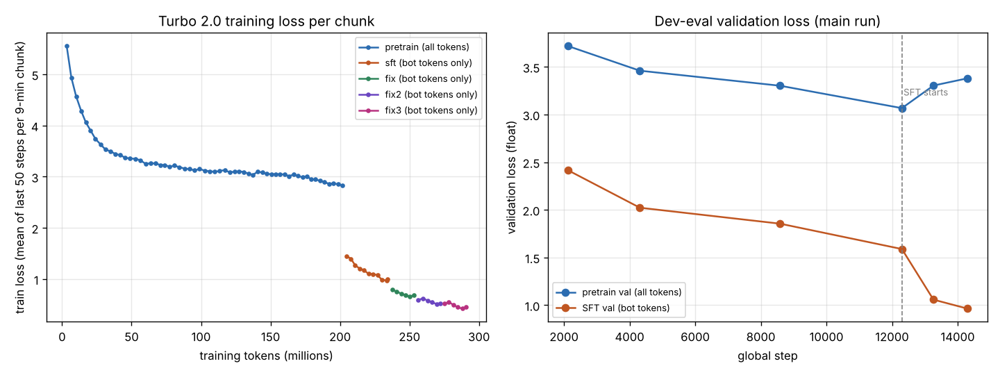

# Turbo 2.0

Turbo 2.0 is a small chatbot that runs entirely inside a Scratch project in TurboWarp. It is a 10.1M-parameter
decoder-only transformer, implemented in Scratch blocks with int8 weights. It runs fully offline: no extensions,
no internet, no API keys and no cloud variables.

Every word of a reply is sampled from the model. Only four things are not:

- **Retrieval** chooses up to two short facts from an 82,039-fact memory for the model to read.
- **Helpers** compute values (time, dates, maths, conversions, …) for the model to relay.
- **`/reset` and `/help`.**
- **UI status messages**, listed under [Decisions](#decisions-and-assumptions-flagged).

**In one line:** Turbo 2.0 beats Turbo 1 clearly. A blind A/B comparison picked it in 97.4% of decided
comparisons (75 wins, 2 losses, 23 ties). It passes **3 of the 8 quality gates**, so it is not yet the reliable
general assistant the brief asked for. The gaps are in [Results](#results-turbo-1-vs-turbo-20) and
[Known limits](#known-limits).

| | |
|---|---|
| Deliverable | `build/Turbo2.sb3` (17,516,124 bytes) |
| Parameters | **10,126,336** |
| Layers | 10, d_model 256, 4 heads, FFN 1024 |
| Context and vocab | ctx 512, vocab 8192 |
| Training | 88 chunks of ≤9 min, 17,750 steps, 290.8M token positions, 12.56 h of training compute (CPU) |
| Speed (headless TurboWarp, this container) | ~27 ms/token prefill and 33–37 ms/token decode; a typical fact question takes 1.9–2.3 s |
| Load (headless) | 1.21–1.27 s to load the project, then 0.27–0.35 s from green flag to "Ready" |

## Using it

1. Open `build/Turbo2.sb3` in TurboWarp (desktop or turbowarp.org).
2. Press the green flag. The Turbo sprite shows load progress, then "Ready!".
3. Type into the ask box. The reply streams into the cat's say bubble token by token. The `chat` list
   monitor on the stage keeps the whole conversation.

`/help` shows a fixed help text. `/reset` clears the conversation.

Two display notes:

- The tokenizer is lowercase-only. Display capitalization only capitalizes the first letter of each sentence and
  "I", so names show as "william shakespeare".
- Times and dates come from Scratch's clock (`current [hour]` and similar) and the computer's UTC offset, which
  is derived from `days since 2000`.

## Results: Turbo 1 vs Turbo 2.0

The eval suite has 618 prompts (`eval/suite.jsonl`). None were trained on (see
[Eval method](#eval-method-and-caveats)). Turbo 2.0 was scored with the Python int8 mirror, which is proven
token-identical to the .sb3. It used default sampled decoding, a fixed clock (2026-11-24 15:05, UTC+7) and seed
1000+item id. Turbo 1 was scored with its own numpy reference.

### Gates

| Gate | Target | Turbo 1 | Turbo 2.0 | Result |
|---|---|---|---|---|
| Helper questions answered correctly | ≥95% | 0.0% | **94.7%** (144/152) | **FAIL** (one item short of 95%) |
| Facts in the knowledge base answered correctly | ≥80% | 1.2% | **80.7%** (134/166) | **PASS** |
| Facts not in the base: confidently wrong | ≤20% | 3.3%¹ | **26.7%** (16/60) | **FAIL** |
| "I don't know"-style replies to answerable prompts | ≤3% | 35.3% | **5.0%** (28/558) | **FAIL** |
| Off-topic or unrelated replies, all 618 prompts | ≤5% | 69.4% | **9.5%** | **FAIL** |
| Multi-turn recall | ≥80% | 37.5% | **85.0%** (34/40) | **PASS** |
| Stories, jokes and explanations, mean blind score | ≥3.5/5 | 1.11 | **2.18** | **FAIL** |
| Blind A/B vs Turbo 1, share of decided pairs | ≥85% | – | **97.4%** (75–2, 23 ties) | **PASS** |

¹ Turbo 1 is rarely "confidently wrong" because it answered "I don't know" to 93% of these questions.

### Per category

| Category | n | Metric | Turbo 1 | Turbo 2.0 |
|---|---|---|---|---|
| Facts in base | 166 | correct | 1.2% | **80.7%** |
| Facts not in base | 60 | confidently wrong / hedged or declined / correct | 3.3 / 96.7 / 0.0% | 26.7 / 70.0 / 3.3% |
| Helpers | 152 | correct call **and** value relayed | 0.0% | **94.7%** |
| Recall (multi-turn) | 40 | correct | 37.5% | **85.0%** |
| Chat | 40 | blind score 1–5 | 2.50 | **4.75** |
| Stories | 30 | blind score 1–5 | 1.10 | 1.50 |
| Jokes | 25 | blind score 1–5 | 1.08 | **3.04** |
| Explanations | 30 | blind score 1–5 | 1.13 | 2.13 |
| Instructions / how-to | 25 | blind score 1–5 | 1.24 | 1.68 |
| Messy input, auto-graded (typos, slang, mixed) | 24 | correct | 0.0% | 33.3% |
| Messy input, open-ended | 26 | blind score 1–5 | 1.19 | **3.15** |
| **All** | 618 | off-topic | 69.4% | **9.5%** |
| **Answerable** | 558 | "I don't know"-style | 35.3% | **5.0%** |

Per-category off-topic rates for Turbo 2.0:

| Category | Off-topic |
|---|---|
| Facts in base | 1.2% |
| Facts not in base | 11.7% |
| Helpers | 0% |
| Chat | 2.5% |
| Recall | 10% |
| Stories | 40% |
| Jokes | 48% (mostly a joke on the wrong topic) |
| Explanations | 6.7% |
| Instructions | 36% |
| Messy input | 12.5% / 26.9% (auto / open) |

Per-item grades are in `eval/graded_turbo2.csv` and `eval/graded_turbo1.csv`. The summary is in
`results/eval_report.json`.

### Fix-pass history

Eval-diagnosed passes added at most 6 SFT chunks each. All stages below were re-graded with the same final
grader. The shipped checkpoint is the end of fix pass 3.

| Stage (step) | Facts in | Confidently wrong | Helpers | Recall | Messy (auto) | IDK on answerable |
|---|---|---|---|---|---|---|
| SFT end (14,300) | 66.3 | 51.7 | 81.6 | 37.5 | 25.0 | 0.9 |
| Fix 1 (15,450) | 69.3 | 28.3 | 93.4 | 75.0 | 29.2 | 0.2 |
| Fix 2 (16,600) | 77.1 | 56.7 | 94.7 | 80.0 | 33.3 | 0.5 |
| **Fix 3 = shipped (17,750)** | **80.7** | **26.7** | **94.7** | **85.0** | **33.3** | **5.0** |

All values are percentages. What each pass contained:

- **Fix 1**: helper phrasing coverage; grounded Q&A with more no-relevant-fact cases; recall and pronoun
  conversations. It cut confidently-wrong answers sharply, but it over-hedged.
- **Fix 2**: less hedging. Facts and recall improved, but confidently-wrong answers jumped to 56.7%.
- **Fix 3**: contrastive "near-miss" examples, where the retrieved fact is about something else and the reply
  says so. This brought confidently-wrong back to 26.7%. The cost is the template "i'm not sure, my notes only
  say that …", which now leaks into answerable questions and raised IDK to 5.0%. In 9 of those 28 replies, the
  correct answer follows the template.

The shipped checkpoint was chosen on gate results, not validation loss. Fix 1 had the lowest SFT validation loss
(see [Training](#training)). The manual grading and the A/B test were run on fix 3 only.

## Ten unedited transcripts from the real .sb3

These come from `build/Turbo2.sb3` running in headless TurboWarp (scratch-vm with the compiler on). The harness
types each message into the ask box and reads the `display` variable that the say bubble shows. Settings were
the default sampled decoding, seed 12345 and a fixed clock (2026-11-24 15:05, UTC+7). `/reset` was sent
between conversations.

The bracketed lines are harness metadata, not shown in the UI:

- the helper call and its result;
- how many facts retrieval inserted;
- the turn's wall time.

All 20 conversations (61 turns) are in `results/sb3_conversations.json`. All 61 turns are token-for-token
identical to the Python mirror. I picked these 10 to cover facts, helpers, a story, jokes and recall. Four of
them show typical failures.

**1. Recall + calculator** (conversation 0)

```text
You:   hi, my name is priyanka
Turbo: Nice to meet you, priyanka!
       [facts inserted: 0; 1.85 s]
You:   i love painting landscapes
Turbo: Cool, thanks for telling me!
       [facts inserted: 1; 1.21 s]
You:   what's 6 times 7?
Turbo: The answer is 42.
       [helper: <tool> calc 6*7 <res> 42; facts inserted: 2; 2.15 s]
You:   what's my name?
Turbo: Your name is priyanka.
       [facts inserted: 0; 0.54 s]
```

**2. Joke + recall** (conversation 5)

```text
You:   my sister's name is lena
Turbo: Oh, that's interesting!
       [facts inserted: 2; 1.43 s]
You:   she is ten years old
Turbo: Oh, nice!
       [facts inserted: 1; 0.99 s]
You:   tell me a joke
Turbo: What do you call a cow that just gave birth? An udder failure.
       [facts inserted: 2; 1.81 s]
You:   how old is my sister?
Turbo: Your sister is 10.
       [facts inserted: 2; 2.07 s]
```

**3. Percent helper + recall** (conversation 7)

```text
You:   i'm learning the guitar
Turbo: Okay, you're learning the guitar
       [facts inserted: 2; 1.65 s]
You:   it's hard but fun
Turbo: Sounds like a good day for a cozy activity! Want a story?
       [facts inserted: 2; 1.59 s]
You:   what's 15% of 60?
Turbo: That's 9.
       [helper: <tool> pct_of 15 60 <res> 9; facts inserted: 2; 2.62 s]
You:   what instrument am i learning?
Turbo: You're learning the guitar.
       [facts inserted: 0; 0.52 s]
```

**4. Calculator, then a fact** (conversation 11)

```text
You:   what's 5 + 5?
Turbo: 10!
       [helper: <tool> calc 5+5 <res> 10; facts inserted: 0; 0.75 s]
You:   cool. who wrote hamlet?
Turbo: William shakespeare was an english playwright who wrote hamlet.
       [facts inserted: 2; 1.85 s]
```

**5. Chained helpers** (conversation 14)

```text
You:   what's 25% of 80?
Turbo: 25% of 80 is 20.
       [helper: <tool> pct_of 25 80 <res> 20; facts inserted: 1; 1.37 s]
You:   and what is 3 to the power of 4?
Turbo: It's 81.
       [helper: <tool> calc 3^4 <res> 81; facts inserted: 2; 2.17 s]
You:   convert 10 miles to km
Turbo: 10 miles is 16.0934 kilometers.
       [helper: <tool> convert 10 mi km <res> 16.0934 kilometers; facts inserted: 0; 1.55 s]
```

**6. Holiday, world time, coin** (conversation 16)

```text
You:   how many days until christmas?
Turbo: Christmas falls on friday, december 25, 2026, in 31 days.
       [helper: <tool> holiday christmas <res> friday, december 25, 2026, in 31 days; facts inserted: 2; 2.91 s]
You:   what time is it in tokyo?
Turbo: It's 5:05 pm, tuesday in tokyo.
       [helper: <tool> world_time tokyo <res> 5:05 pm, tuesday; facts inserted: 2; 2.50 s]
You:   flip a coin
Turbo: The coin landed on heads.
       [helper: <tool> coin <res> heads; facts inserted: 1; 1.70 s]
```

**7. Facts and explanations (the last answer is wrong)** (conversation 17)

```text
You:   who wrote romeo and juliet?
Turbo: William shakespeare was an english playwright who wrote romeo and juliet.
       [facts inserted: 2; 1.79 s]
You:   what is photosynthesis?
Turbo: Photosynthesis is how plants use sunlight to make food and oxygen.
       [facts inserted: 2; 2.53 s]
You:   why is the sky blue?
Turbo: The sky blue is a variation of blue that is often described as the color of the sky on a clear day.
       [facts inserted: 2; 2.90 s]
```

**8. Persona drift (failure)** (conversation 13)

```text
You:   hi! who are you?
Turbo: I am a big fan of the new tv shows and they are amazing. Do you watch television?
       [facts inserted: 0; 0.94 s]
You:   what can you do?
Turbo: I watch a lot of other shows though. There is also an episode where south park and the simpsons are playing. They are so family guy.
       [facts inserted: 0; 1.27 s]
You:   what is the capital of japan?
Turbo: The capital of japan is tokyo.
       [facts inserted: 2; 1.17 s]
You:   thanks!
Turbo: No problem. Have a good day.
       [facts inserted: 0; 0.47 s]
```

**9. Near-miss fact leak (failure)** (conversation 10)

```text
You:   tell me a joke
Turbo: Why did the chicken cross the road? To get to the other side!
       [facts inserted: 2; 1.66 s]
You:   now tell me about the sun
Turbo: I don't have that one in my notes. What I do know is that jupiter means relating to or derived from the sun or utilizing the energies of the sun.
       [facts inserted: 1; 2.28 s]
```

**10. Story degenerates (failure)** (conversation 15)

```text
You:   tell me a story about a fox who learns to swim
Turbo: Here's a story for you. On the first day of fourth grade, leo and hismione started a fearland that was too old. Leo swirled their way through the sky, thedores were tired. But leo didn't tire very much. It showed them a real understanding. The far away from the far away from the far away from the far away from the far away from the far away. Leo threw a hungry little faster, more so that bubbles, onemostspoonmble ofe and a ple kilometerse. At first, there were ocean monsters and big jellyfish. But crunchy, it was a strange thing. But leo was serious of hisnomione and asked them what was wrong. But then he found a sign that said "for an extended period, about halfway through!" They gave them a word for leo. The boy, very grandpa, wrapped and took leo a treat. Then they tried
       [facts inserted: 0; 8.33 s]
You:   that was nice. tell me a joke
Turbo: Why did the scarecrow win an award? Because he was outstanding in his field! I'll show myself out.
       [facts inserted: 2; 2.63 s]
```

The parity check (greedy decoding) produced a better story opening for "tell me a story about a kind dragon":
"In a land of enormous dragons, there was one named pip who was no bigger than a cat…". That opening is close
to one of the original training stories. Stories are the weakest category; see [Known limits](#known-limits).

## Speed and size

All timings were measured in headless TurboWarp: scratch-vm in Node with the compiler enabled and warp mode for
the hot loops. They ran on this container's CPU. Scratch runs on one thread.

**Browser TurboWarp was not measured.** Expect it to be somewhat slower, with load time depending on download and
unzip.

| Measure | Value | Source |
|---|---|---|
| Project load (`vm.loadProject` of the .sb3) | 1,211–1,269 ms | `results/sb3_conversations.json`, `results/verify_final.json` |
| Green flag → "Ready!" (unpack weights, allocate KV cache) | 269–348 ms | same |
| Prefill | ~27 ms/token warm; 63.6 ms/token on the first turn after load (JIT warm-up) | `results/verify_final.json` |
| Decode | 33.3–37.4 ms/token | same |
| Typical fact turn | 1.9–2.3 s (target ≤30 s) | same |
| 61 turns of the 20 conversations | median 1.44 s, range 0.38–8.33 s | `results/sb3_conversations.json` |
| Turns with ≥1 fact inserted | median 1.65 s, max 3.37 s | same |
| Longest turn | 8.33 s (a 200-token story) | same |
| `project.json` | 52,620,435 bytes | `results/build_stats.json` |
| `.sb3` | 17,516,124 bytes | same |
| Blocks | 19,600 | same |
| Custom blocks | 86 | same |
| Lists | 187 | same |
| Variables | 790 | same |
| Largest list | 199,000 items (limit 200,000) | same |

## Verification of the real .sb3

All checks ran on the final build. Results are in `results/verify_final.json` and
`results/helper_tests_final.json`.

**Logit parity with the Python int8 mirror** (`mirror.py`): PASS.

- Inputs: 6 conversations, 8 turns:
  - a persona turn;
  - fact turns with 1–2 facts;
  - a natural tool turn (`pct_of 17.5 240` → 42);
  - a forced tool turn;
  - a 40-token story;
  - a recall turn.
- Max |logit difference| across all positions: **3.0e-14**.
- Greedy decoding was exact for all 119 tokens, and the tool calls, tool results and display text were
  identical.
- A separate build with random weights (`results/verify_random10.json`) decoded the full 40 greedy tokens on
  every turn, also exactly.

**Sampled-decoding parity** (default T, top-k, penalty, LCG): PASS on 3 turns. The 20 real-.sb3 conversations
add 61 more sampled turns, all identical to the mirror.

**Retrieval parity** (Scratch BM25 vs the Python twin): **200/200** queries pick identical facts. 178 of the
queries inserted at least one fact.

**Helpers** (Scratch vs Python twins): **1,927/1,927** cases match. Every one of the 35 helpers has at least 50
cases.

**Quantization** (int8 vs float, final checkpoint, 400 validation windows; `results/quant_check.json`):

| Validation set | Float | int8 | Change |
|---|---|---|---|
| Pretraining | 3.57529 | 3.57641 | +0.031% |
| SFT | 1.03164 | 1.03244 | +0.078% |

The spec allows ≤3%.

**Tokenizer:** 8,192 entries. Scratch's `Cast.compare` finds **0** equal pairs among all 33,550,336 pairs
(`results/vocab_check.txt`).

**Resume:** checkpoint/resume is bitwise identical to an uninterrupted run in eager mode (`results/resume_proof.json`).

- Parameter difference: 0.0.
- Adam state difference: 0.0.
- Data cursor and step: equal.

With `torch.compile`, CPU kernels are nondeterministic across processes, at the same level with or without a
resume. The main run used compile for speed.

## Model and Scratch implementation

**Model:**

- Decoder-only GPT with pre-LN blocks and causal attention.
- Learned positional embeddings.
- Tied input embedding and LM head.
- GELU uses the tanh approximation, with identical formulas in PyTorch, `mirror.py` and Scratch.
- LayerNorm eps is 1e-5. Softmax subtracts the max.
- 10 layers, d_model 256, 4 heads of 64, FFN 1024, ctx 512, vocab 8192: **10,126,336 parameters**.
- The spec's "≥12 tokens/param in 10 h" rule was met without growing the model. Pretraining alone was 19.9
  tokens/param.

**Weights:**

- All weight matrices are int8 with one scale per output row, including the tied embedding/head and the
  positional embedding.
- Biases and LayerNorm gains and biases stay as float values, written with 8 significant digits.
- Weights are stored in Scratch lists of at most 199,000 items, split across several lists.

**Inference in Scratch:**

- Warp-mode custom blocks with indexed item access.
- Dot products are unrolled ×4.
- A KV cache per layer.
- On overflow, the oldest whole exchanges are dropped when `history + new turn + 240 > 512`, and then the cache
  is rebuilt.

**Decoding:**

- Temperature 0.3 when a fact was inserted, during a tool call, and after a tool result. 0.75 otherwise.
- Top-k 40.
- Repetition penalty 1.15 over the last 64 tokens of the current reply. Digits, space, "." and "," are exempt.
- Special tokens are masked, except `<end>`. `<tool>` is allowed only as a reply's first token.
- A reply stops at `<end>` or 200 tokens.
- Random numbers come from a seeded LCG: `seed = (seed*1664525 + 1013904223) mod 2^32`.

**Prompt format:**

```
<user> message <fact> fact 1 <fact> fact 2 <bot> reply <end>
```

A tool turn looks like this:

```
<bot> <tool> name args <res> result <bot> reply <end>
```

The model writes `<tool> name args <res>`. Scratch then runs the helper, appends the result and a second `<bot>`,
and the model writes the reply.

**Tokenizer:**

- Lowercase, greedy longest-match, 8,192 entries.
- Ids 0–5 are the special tokens `<user> <bot> <end> <fact> <tool> <res>`, which exist only as ids.
- Every piece containing a digit is exactly one digit.
- Pieces never cross a word/punctuation boundary: each is ` ?[a-z_']+` or a single character.
- The character set has 64 symbols; other characters are folded or dropped (`textnorm.py`).

**Build:**

- `scratch/sscompile.py` compiles a small Python subset ("ScratchScript") to Scratch 3 `project.json`.
- The kernels are in `scratch/kernels.py`, the runtime in `scratch/runtime_src.py`, and the helpers in
  `helpers/scratch_tools.py`.
- `validate()` fails the build on any of these:
  - duplicate or dangling block ids, or a parent/next link mismatch;
  - a malformed input or shadow;
  - an undeclared variable, list or broadcast;
  - a custom-block call whose arguments do not match its prototype;
  - a serialization grep failure: `[1, blockId]` anywhere other than the canonical shadow links, or a literal
    that equals a block id.
- The builder also asserts that every list is under 200,000 items.

## Data

Sources were fetched only from GitHub and PyPI (`data/fetch.sh`). Hugging Face was blocked and was not needed.

### Pretraining stream

The table shows how much of each source the pretraining stream used. Tokens are counted with the Turbo 2.0
tokenizer (`results/pack_pretrain2_stats.json`).

| Share (spec → actual) | Source | License | Unique tokens | Used tokens | Epochs |
|---|---|---|---|---|---|
| Knowledge 40% → **44.5%** | Wikipedia 2017-10-01 dump, piece 00 (gensim-data release): article leads | CC BY-SA 3.0 | 141.1M | 90.0M | 0.64 |
| | Fact-base sentences (`factstext`) | (as their sources) | 1.40M | 4.20M | 3.0 |
| Conversation 20% → **20.9%** | Topical-Chat (Amazon) | CDLA-Sharing 1.0 | 5.46M | 13.66M | 2.5 |
| | Taskmaster 1–3 (Google) | CC BY 4.0² | 14.86M | 22.28M | 1.5 |
| | Schema-Guided Dialogue (DSTC8, Google) | CC BY-SA 4.0 | 5.52M | 8.26M | 1.5 |
| Instructions 10% → **10.5%** | AlpacaDataCleaned | data CC BY-NC 4.0, code Apache-2.0³ | 6.96M | 22.28M | 3.2 |
| Q&A and definitions 10% → **5.1%** | OpenTriviaQA, rewritten as Q&A (14 eval questions removed) | CC BY-SA 4.0 | 2.18M | 7.64M | 3.5 |
| | WordNet 3.0 definitions (nltk_data zip) | WordNet license (permissive) | 0.90M | 3.15M | 3.5 |
| | Tables from PyPI packages: countries, capitals, currencies, elements, units | pycountry LGPL-2.1, countryinfo MIT, periodictable public domain, Pint BSD-3 | 0.03M | 0.10M | 3.5 |
| Stories 10% → **11.0%** | Wikipedia plot summaries (same dump) | CC BY-SA 3.0 | 12.59M | 22.66M | 1.8 |
| | **207 original stories**, written for this project (`data/stories/`, 150–185 words each) | this project | 0.20M | 0.70M | 3.5 |
| Jokes 3% → **0.4%** | official_joke_api, taivop/joke-dataset (wocka, stupidstuff, reddit), filtered hard | MIT; taivop: research use, no license⁴ | 0.23M | 0.81M | 3.5 |
| Synthetic tool use and grounded Q&A 7% → **7.5%** | Generated (`sft/gen_sft.py`, `sft/tool_gen.py`) with real helper outputs | this project | 15.79M | 15.79M | 1.0 |
| **Total** | | | | **211.5M** in 417,476 windows of 513 tokens | |

Pretraining consumed 201.5M of these token positions: 12,300 steps × 16,384 tokens.

² The Taskmaster license was taken from the repository's READMEs. The fetched checkout has no LICENSE file.

³ AlpacaDataCleaned's README states the data is CC BY-NC 4.0 (non-commercial). **Turbo 2.0 therefore inherits a
non-commercial restriction.**

⁴ taivop/joke-dataset is "provided for research purposes", with no license and copyright on jokes unclear.
Together these make the model suitable for personal and educational use only.

**Gaps against the spec's shares:**

- **Jokes: 0.4% instead of 3%.** After the family-friendly filter only 7,350 jokes remained (772K characters).
  The ≤4-epoch cap held the share to 0.4%. The SFT and fix data later used a stricter set of 6,954 jokes
  (`jokes_clean`).
- **One dark joke reached pretraining.** After pretraining, I found one joke with a serial-killer reference.
  The stricter `jokes_clean` set was built for later stages, but pretraining had already seen the original set.
- **Q&A and definitions: 5.1% instead of 10%.** The sources are small, and the ≤4-epoch cap limited them. The
  difference went to knowledge.

**Coverage topics:** `facts/core_facts.txt` holds 367 hand-written facts on coverage topics:

- space
- the body and health basics
- animals
- geography
- science
- history
- maths words
- everyday life

These feed both the fact base and pretraining.

### SFT and fix data

All SFT and fix data is generated (`sft/gen_sft.py`, `sft/fix_gen.py`). Loss is computed on bot tokens only.

| Pack | Conversations | Windows | Bot-token targets | Trained |
|---|---|---|---|---|
| SFT (`sft` + `sft2`) | 140.9k + 84.5k | 49,393 | 11.67M | 2,000 steps ≈ 1.3 epochs |
| Fix 1 | — | 23,391 | 4.81M | 1,150 steps ≈ 1.6 epochs |
| Fix 2 | — | 21,188 | 4.10M | 1,150 steps ≈ 1.7 epochs |
| Fix 3 | — | 20,199 | 4.02M | 1,150 steps ≈ 1.8 epochs |

The SFT data covers:

- **Helpers**:
  - all 35 helpers, with templates × fillers × typo/slang noise. A 60,000-sample draw gives 1,072–1,786
    distinct user messages per helper (`python3 sft/tool_gen.py`); numbers and slot values vary too;
  - every value is computed by the Python twin, which matches Scratch exactly.
- **Grounded Q&A** built from the fact base. Retrieval runs exactly as at runtime, so facts are inserted the way
  Scratch will insert them. About 15% of cases have no relevant fact, and the reply says it does not have that
  in its notes.
- **Multi-turn conversations**: persona ("about me"), name, pet, hobby and family recall, topic switches, and
  corrections.
- **Original stories**, cleaned jokes, Alpaca instructions and Topical-Chat turns.

"I don't know" plus a helpful pointer makes up 2,400 of the 140,900 SFT conversations (1.7%). Questions with no
relevant fact (the 15% case) get a hedged best answer instead ("i'm not completely sure, but i think …").

Fix pass 3 added 14,000 contrastive near-miss conversations out of 106,500 (`sft/fix_gen.py: MIX`). Their replies
decline and then quote the related fact, which is where the near-miss template leak comes from.

The **eval guard** (`EvalGuard`) drops any training example that:

- shares an 8-gram with an eval prompt;
- exactly matches an eval prompt;
- is Q&A built from an eval fact (`eval/eval_fact_ids.json`).

## Fact memory and retrieval

The base holds **82,039 deduplicated facts**, each ≤24 tokens (mean 18.2), in `facts.jsonl` built by
`facts/build_facts.py`:

| Source | Facts |
|---|---|
| Wikipedia first sentences, shortened at clause boundaries, with title-word and stale-date filters | 61,693 |
| OpenTriviaQA, rewritten as statements | 9,083 |
| WordNet definitions | 9,034 |
| PyPI tables (capitals, currencies, elements, …) | 1,759 |
| Hand-written core coverage facts | 367 |
| Hand-written 2026 overlay | 70 |
| Hand-written "about me" | 33 |

The **2026 overlay** (`facts/overlay_2026.txt`) and the **about-me** facts (`facts/about_me.txt`) were written by
me from my own knowledge, which runs to mid-2026. They were not checked against outside sources. Facts that can
change are phrased as dated events, for example "Keir Starmer became prime minister of the United Kingdom in
July 2024".

**Retrieval** is word-level BM25 over the facts (`facts/bm25.py` is the Python twin of the Scratch blocks).

- **Normalization:**
  - letters and digits are split ("covid19" → "covid 19");
  - `'s` is removed and leading zeros are stripped;
  - light stemming: `ies`→`y`, plural `s`, and `ing`/`ed` on words longer than 5 letters;
  - a small synonym map: verb and agent forms, roman numerals;
  - one stopword list.
- **Scoring:** k1 1.2, b 0.5. Posting weights are rounded to 3 decimals. Words in more than 5% of facts are not
  indexed.
- **Definition boost:** "mean / define" questions add +3 to WordNet definition facts.
- **Insertion:** the top fact goes in if its score is ≥9 and score/query-mass is ≥0.5. A second fact also needs
  ≥0.8× the top score. Ties go to the lowest fact id.
- **Shipping format:** the index ships as Scratch lists — 550,135 postings and 1,495,008 fact-token items.

**Thresholds** were tuned on a dev set of generated questions (`results/retrieval_tuning.json`), never on the eval
prompts.

- Recall on 2,500 answerable questions: **91.2%**.
  - Trivia: 98.9%.
  - Capitals: 100%.
  - Wikipedia: 89.2%.
  - WordNet: 73.0%.
- On 104 non-factual prompts (chit-chat, helper, story, joke and advice prompts), **58.7% still got a fact
  inserted**. The SFT data teaches the model to ignore facts that do not apply, and in chat it mostly does.
- In the eval, 36 of the 60 questions whose answer is not in the base (60%) got a near-miss fact inserted. The
  model has to recognize these itself, which is the main source of the "confidently wrong" and "near-miss leak"
  failures.

## Helpers

There are 35 helpers. Each has a Python twin (`helpers/twins.py`) and a Scratch implementation
(`helpers/scratch_tools.py`), and **1,927/1,927** test cases match (`helpers/test_cases.py`). The call syntax is
`<tool> name args <res> value`, with a canonical argument grammar.

| Group | Helpers |
|---|---|
| Clock and calendar | `time`, `date`, `weekday`, `days_until`, `days_since`, `date_add`, `age`, `leap`, `week` |
| World time | `world_time` for 56 cities, using a DST transition table for 2024–2040 precomputed from zoneinfo |
| Holidays | `holiday`, 34 holidays for 2024–2040: international (New Year, Easter, Thanksgiving, Christmas, Chinese New Year, Diwali, Eid al-Fitr, …) and Thai (Songkran, Makha/Visakha/Asarnha Bucha, Chakri Day, King's Birthday, Chulalongkorn Day, …). Dates come from the `holidays` package (MIT) and fixed rules. |
| Maths | `calc` (+ − × ÷ ^ %, parentheses; JS number formatting), `pct_of`, `pct_is`, `pct_change`, `tip`, `discount`, `prime`, `factors`, `gcd`, `lcm`, `roman` (both directions), `words` (number → words) |
| Units | `convert`: length, mass, volume, speed, area, time, data, temperature (49 units) |
| Random | `coin`, `dice`, `rand`, `pick`, using the same seeded LCG as decoding |
| Text | `sort`, `reverse`, `spell`, `count_letter`, `count_letters`, `count_words` |
| Timer | `timer`: when it finishes, a notice appears in the chat list and the say bubble |

## Training

Training ran on CPU: 4 cores, PyTorch 2.15, bf16 autocast, `torch.compile`.

- **Steps:** micro-batch 16 × 512 tokens, with gradient accumulation 2, for 16,384 tokens per step.
- **Packing:** sequences are packed with block-diagonal causal attention, and positions restart per segment.
- **Optimizer:** AdamW (0.9, 0.95), weight decay 0.1 on matrices, gradient clip 1.0.
- **Learning rate:** a pure function of the global step (`train.py: lr_at`), so a resume can never restart it.

**Chunks and checkpoints:** each command trains for ≤9 minutes and then saves atomically (temp file + rename).
The checkpoint holds:

- model;
- optimizer;
- step;
- per-phase data cursor;
- torch, numpy and python RNG states.

| Phase | Chunks | Hours | Steps | LR schedule | Train loss (first → last chunk) |
|---|---|---|---|---|---|
| Pretraining | 59 | 8.536 | 12,300 | WSD: 300 warmup, peak 1.2e-3, linear decay over the last 20% to 10% | 8.66 → 2.83 |
| SFT (bot tokens only) | 11 | 1.478 | 2,000 | 50 warmup, 3e-4, decay over the last 30% to 10% | 1.62 → 1.00 |
| **Main run total** | **70** | **10.014** | **14,300** | | |
| Fix pass 1 | 6 | 0.848 | 1,150 | 30 warmup, 2e-4, linear to 10% | 0.96 → 0.68 |
| Fix pass 2 | 6 | 0.839 | 1,150 | same | 0.63 → 0.53 |
| Fix pass 3 | 6 | 0.855 | 1,150 | same | 0.62 → 0.45 |
| **All** | **88** | **12.556** | **17,750** | | |

Throughput was 5,795–7,120 tokens/s, with a pretraining mean of 6,557. Compile warm-up added 0.10 h on top of
the times above.



`results/loss_curves.png` has two panels:

- **Left:** training loss per chunk (mean of the chunk's last 50 steps) against tokens.
- **Right:** held-out validation loss, 200 windows each:

| Step | Stage | Pretraining val | SFT val |
|---|---|---|---|
| 2,120 | pretraining | 3.7187 | 2.4158 |
| 4,312 | pretraining | 3.4599 | 2.0225 |
| 8,586 | pretraining | 3.3022 | 1.8551 |
| 12,300 | end of pretraining | **3.0671** | 1.5889 |
| 13,261 | SFT | 3.3040 | 1.0583 |
| 14,300 | end of SFT | 3.3801 | 0.9638 |
| 15,450 | end of fix 1 | 3.4530 | **0.9581** |
| 16,600 | end of fix 2 | 3.5215 | 0.9878 |
| 17,750 | end of fix 3 (shipped) | 3.5891 | 0.9986 |

The last three rows are in `results/stage_val_losses.json`. SFT and the fix passes raise the loss on raw
pretraining text, as expected. The fix passes also raise SFT validation loss a little: the fix data targets eval
failure modes rather than the SFT distribution.

## Eval method and caveats

**Suite:** 618 prompts (`eval/build_suite.py`):

| Category | Prompts |
|---|---|
| Facts in base | 166 |
| Facts not in base | 60 |
| Helpers | 152 |
| Chat | 40 |
| Recall | 40 |
| Stories | 30 |
| Jokes | 25 |
| Explanations | 30 |
| Instructions | 25 |
| Messy input | 50 |

Facts-in-base prompts are paraphrased questions about facts that are in the base. Facts-not-in-base prompts have
no supporting fact.

**Automatic grading** (`eval/grade.py`):

- **Facts:** the reply contains a key answer string.
- **Helpers:** the exact expected call result appears in the reply. For random helpers, the right helper was
  called and its result relayed.
- **Recall:** the reply contains the remembered detail.
- **"I don't know"-style:** the reply matches a decline phrase and contains no attempted answer. "Not sure, but
  I think X" counts as an answer.
- **Off-topic, auto categories:** a wrong reply with no content word in common with the prompt or the answer
  keys. This heuristic is crude.

**Manual grading:** 352 open-ended replies (both models), plus off-topic flags for those categories.

- I graded them myself (Claude, the same agent that built Turbo 2.0) on a 1–5 scale:
  - 1 = broken or unrelated;
  - 3 = acceptable with clear flaws;
  - 5 = good.
- The sheets were shuffled and hid which model wrote each reply (`eval/blind_sheet.txt`; the key was kept in a
  separate file).
- **Caveat:** the two models' styles are easy to tell apart, so the grading is not truly blind. I graded
  carefully, but I have a stake in the result.

**A/B test:** 100 prompts stratified over all categories, with A/B order randomized (`eval/ab_sheet.txt`,
`eval/ab_judgments.json`, scored by `eval/ab_score.py`). It was judged by me with the same caveat.

- Turbo 1 won 2 prompts: one recall and one not-in-base fact.
- Ties were mostly stories (5) and not-in-base facts (5), where both replies were poor.

**Second-opinion check:** an independent human second opinion on `eval/blind_sheet.txt` and `eval/ab_sheet.txt`
would make these numbers more trustworthy. The sheets are self-contained.

**Leakage checks:**

- No eval prompt appears in training data: 8-gram and exact-match filter, plus no Q&A built from eval facts.
- 14 OpenTriviaQA questions that matched eval items were removed from the pretraining trivia.
- Eval facts stay in the fact base (that is the "facts in base" condition), and plain Wikipedia text can of
  course mention them.

**Turbo 1 baseline:** no Turbo 1 file was attached. The only Turbo-like project available was the
`scratch-chatbot/` project on branch `claude/scratch-transformer-chatbot-xsitsq` (persona "byte"):

- 1,353,728 parameters, 6 layers, d128, vocab 1024, ctx 256;
- **no time/date helpers**.

The brief describes Turbo 1 as about 2M parameters with a vocab of about 3K and time/date helpers, so this may
not be the same Turbo 1. Its numpy reference is in `baseline/`. Its 0% on helpers reflects having no helpers at
all.

## Known limits

**Knowledge:**

- Knowledge is mostly a **2017 Wikipedia snapshot** plus 70 hand-written facts for 2018 to mid-2026.
- Anything not in the 82k facts is answered from model memory, which is unreliable for a 10M-parameter model.

**Confident wrong answers and near-misses.** For questions the base cannot answer, 26.7% of replies are
confidently wrong, often by copying a near-miss fact:

- "who won the 2023 rugby world cup?" → "the 1995 rugby world cup was the third rugby world cup."
- "what does the abbreviation nasa stand for?" → an invented expansion.

Retrieval inserted a near-miss fact for 36 of these 60 questions, and the model often reads that fact as the
answer.

**Near-miss template leak.** The template "i'm not sure, my notes only say that …" (or "I don't have that one in
my notes. What I do know is …") appears on 28 answerable prompts (5%). Sometimes the true answer follows it:

- "how many keys are on a piano" → "i'm not sure, my notes only say that a piano has 88 keys."

Other times the retrieved fact is wrong:

- "what is the chemical formula of water?" → a note about hydrogen fluoride.

**Helper argument slips.** 8 of 152 helper prompts failed. Most failures were copying an argument wrong:

| Prompt | What went wrong |
|---|---|
| "144 divided by 12" | → `calc 14/12` |
| "wat time is it in tokio" | → `world_time chicago` |
| "1000 meters in yards" | → `convert 1000 ms yd` (meters per second) |
| "days until new year's eve" | → `holiday new_year` |
| "which weekday is christmas 2030 on" | → `weekday 2030-06-20` |

Two more failed on the reply side:

- one prompt called no tool;
- in one case the result was not relayed ("thanksgiving has a note about your note").

**Stories:** mean blind score 1.5/5.

- Short prompts often get a near-recitation of one of the 207 training stories, sometimes ignoring the requested
  topic.
- Long stories drift into nonsense words and loops by 100–200 tokens (transcript 10).
- Original stories make up only 0.33% of pretraining. Wikipedia plot summaries are not bedtime stories.

**Jokes:** 3.04/5 on average, but 48% are a joke on the wrong topic. Turbo 2.0 knows a set of stock jokes and
cannot write a new one about a requested subject.

**Explanations and how-to:** 2.13/5 and 1.68/5. Replies are short. They often restate a definition ("the sky
blue is a variation of blue…") instead of explaining why or how.

**Persona drift:**

- Topical-Chat and Taskmaster/SGD habits sometimes surface: chatting about TV shows, or booking-style replies
  ("i have 20 pairs at 8 pm…").
- "Who are you?" usually gets the Turbo persona, but not always (transcript 8).

**Context:**

- History plus the new message (with its facts) must fit in 272 tokens: 512 minus a 240-token reserve for the
  reply.
- Older exchanges are dropped whole, so recall fails after a few long turns.
- Recall is 85% on short conversations.

**Display:** the vocabulary is lowercase, so proper nouns are not capitalized.

**Speed:** about 2 s per short reply and about 8 s for a 200-token story in headless TurboWarp. These times were
measured on this container's CPU. In a browser and on slower machines it will be slower, which I have not
measured.

**Licenses:** AlpacaDataCleaned (CC BY-NC 4.0) and the taivop jokes ("research purposes") make the weights
unsuitable for commercial use.

## Decisions and assumptions (flagged)

**Workspace:** 4 CPU cores, 15 GB RAM, torch 2.15. I measured throughput first: about 5,500 tok/s planned and
6,100–7,100 achieved. I kept the spec model size, since it already reached ≥12 tokens/param.

**Run length changed during training:**

- After chunk 1 and chunk 4, throughput was higher than planned. I raised `pretrain_steps` from 9,600 to 10,600
  and then to 12,300.
- After chunk 4, I re-packed the pretraining data to 211.6M tokens (`pack/pretrain2`) so the run would fill
  about 10 h. Steps 0–836 came from the first pack. Fewer than 4% of later windows can repeat ones seen in
  those steps.
- `sft_steps` went 2,100 → 2,400 → 2,600 → 2,000, so pretraining plus SFT stayed at 10.01 h.
- Every change was made while the LR was in a phase where the schedule was unaffected.

**Chunk 1 exceeded the 10-minute command limit.** A 540 s budget plus a 40 s cold compile went over once. That
chunk finished in the background and saved normally. Later chunks used a 520 s budget.

**Fix passes run past 10 h.** The 3 fix passes, 2.54 h in total, ran after the 10-hour main run. That follows
the brief's "up to 3 fix passes of ≤6 SFT chunks", but it means total training time was 12.56 h.

**Non-model text shown in the UI:**

- the loading progress;
- "Ready! …";
- "Conversation cleared. Say hi!" after `/reset`;
- the `/help` text;
- the timer's "Time's up! (label timer)" notice.

I count the timer notice as helper output, not a reply. All replies to user messages are sampled.

**Decoding details not fixed by the spec:**

- Low temperature (0.3) is also used *during* a tool call and right after a result, so arguments and values are
  copied faithfully.
- `<tool>` is allowed only as a reply's first token.
- Digits and basic punctuation are exempt from the repetition penalty, so numbers like "100" or "3.14" are not
  penalized.

**Scratch serialization:**

- Shadow inputs use the canonical `[1, blockId]` form.
- Broadcast inputs use type 11.
- The build fails if any list exceeds 200,000 items or any id is dangling.

**BM25 additions:** the stemming and synonym map are my own additions to plain BM25. They were tuned on a dev set
that does not overlap the eval set.

**Grading rules:** the "I don't know" and off-topic classifiers are my definitions, given above. Both models are
graded by the same code.

**Hand-written content (by me):**

- 207 stories;
- 367 core coverage facts;
- 70 facts in the 2026 overlay;
- 33 about-me facts;
- the SFT reply templates.

The about-me facts say Turbo 2.0 was made by Matt, as the brief specifies.

**Turbo 1:** see the eval caveats above.

## Reproducing

The data, packs and checkpoints live outside the repository in `/home/user/work`. Each script's docstring gives
its exact arguments. The order is:

1. **Sources and documents**
   - `bash data/fetch.sh`
   - `data/wiki_split.py`, then `data/wiki_clean.py`
   - `data/prep_dialogue.py`, `data/prep_misc.py`, `data/finalize_docs.py`
2. **Tokenizer:** `tok/build_vocab.py`, then `node harness/check_vocab.js` (the Cast.compare check).
3. **Facts and retrieval**
   - `facts/build_facts.py`
   - `facts/bm25.py`
   - `facts/tune_retrieval.py`
4. **Helpers:** `helpers/build_tool_test.py CASES OUT.sb3`, then `node harness/run_tool_tests.js …`.
5. **Eval suite:** `eval/build_suite.py`. It must run before SFT generation, because the eval guard reads it.
6. **SFT and synthetic data:** `sft/gen_sft.py {sft|sft2|synth|synth2|sftval} OUT [scale]` and
   `sft/fix_gen.py OUT SEED SCALE`.
7. **Packing:** `data/tokcache.py NAME [--sft]`, then `data/pack.py configs/mix_*.json OUTDIR`.
8. **Training**
   - Start: `python3 train.py --run main --init_run configs/run_main.json`.
   - Then repeat `python3 train.py --run main --budget 520` until it prints `{"done": true}`.
   - Run `python3 dev_eval.py main` every ~10 chunks.
9. **Export and quantization check:**
   `python3 export.py CKPT OUT.npz --val PACKDIR… --report results/quant_check.json`
10. **Build:** `python3 scratch/builder.py --weights OUT.npz --out build/Turbo2.sb3`
11. **Verify:** `python3 verify.py build/Turbo2.sb3 OUT.npz results/verify_final.json`
12. **Eval**
    - `eval/run_eval.py OUT.npz eval/turbo2_replies.jsonl`
    - `eval/run_turbo1.py TURBO1.sb3 eval/turbo1_replies.jsonl`
    - `eval/grade.py turbo2` and `eval/grade.py turbo1`
    - `eval/blind_sheets.py`
    - manual grading into `eval/manual_scores.json` and `eval/ab_judgments.json`
    - `eval/ab_score.py`
    - `eval/report.py`
    - `eval/sb3_convs.py build/Turbo2.sb3 OUT.npz`

`progress.json` records the run state, and `NOTES.md` has the working notes.

## File map

| Path | What it is |
|---|---|
| `build/Turbo2.sb3` | **the deliverable** |
| `model.py`, `train.py` | PyTorch model, chunked trainer, LR schedule |
| `export.py` | int8 export and the quantization check |
| `dev_eval.py` | periodic dev eval |
| `mirror.py` | Python int8 mirror of the Scratch runtime: model, retrieval, session, decoding |
| `verify.py` | parity, retrieval and speed checks against the real .sb3 |
| `textnorm.py`, `tok/` | character set, tokenizer, vocab (`tok/vocab.json`) |
| `data/` | fetching, cleaning, packing, original stories (`data/stories/`) |
| `facts/` | fact-base builder, hand-written facts, BM25 and threshold tuning |
| `helpers/` | Python twins, Scratch helper source, test cases |
| `scratch/` | ScratchScript compiler, kernels, runtime, UI builder |
| `harness/` | headless TurboWarp drivers (Node) |
| `sft/` | SFT and fix-pass data generators |
| `eval/` | suite, runners, grader, blind sheets, manual scores, A/B, report, per-item CSVs |
| `baseline/` | Turbo 1 reference implementation used for scoring |
| `configs/` | run config and data mixes |
| `results/` | every measured number quoted above, plus `loss_curves.png` |
